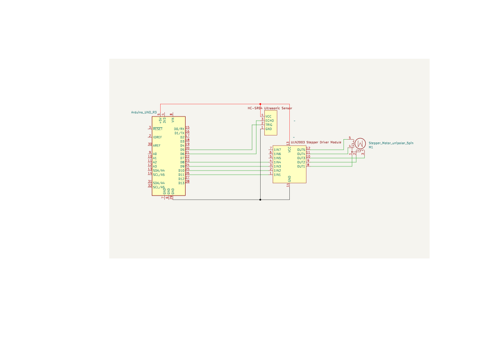

# Arduino Ultrasonic LiDAR Simulation

A simulated 2D LiDAR system using an Arduino UNO R3, an SR04 ultrasonic sensor and a stepper motor.

The project combines embedded hardware with a C++ application running on a Linux device. The Arduino performs the scan and transmits measurement data over a serial connection. The C++ application parses the measurements, builds a point cloud and visualizes the result using SDL2.

> **Portfolio project:** This repository demonstrates embedded C++, serial communication, CMake-based builds and real-time visualization.

## Project Overview

- 2D scanning of the environment using an ultrasonic sensor
- Stepper-controlled rotation for area coverage
- Serial data transmission from the Arduino to a Linux computer
- C++ parsing and point-cloud generation
- SDL2-based visualization of the collected points

## System Architecture

```text
SR04 ultrasonic sensor
          ↓
Arduino UNO + stepper motor
          ↓  serial measurement data
C++ serial reader
          ↓
Line parser and point cloud
          ↓
SDL2 renderer
```

The Arduino is responsible for controlling the sensor and the stepper motor. The Linux application receives the scan data, converts distance and angle measurements into points and renders the resulting scan.

## Hardware

The project is designed for the following components:

- Arduino UNO R3
- SR04 ultrasonic sensor
- Stepper motor
- Appropriate motor driver and power supply
- USB connection between the Arduino and the Linux device

The sensor should be mounted on the stepper motor so that the motor can rotate the sensor while measurements are collected.

Use the wiring diagram as a reference and verify the pin assignments against the firmware before connecting the hardware.



> **Demo media:** Add a photo of the assembled hardware and/or a short GIF or video of the running scan here. Demo media is not included yet.

## Software Structure

- `src/` – Linux-side C++ application
- `src/SerialReader.*` – serial-port communication
- `src/LineParser.*` – parsing of incoming measurement lines
- `src/PointCloud.*` – storage of calculated scan points
- `src/Renderer.*` – SDL2 visualization
- `tests/` – unit-test sources
- `images/` – hardware and wiring documentation

## Requirements

### Hardware

- Arduino UNO R3
- SR04 ultrasonic sensor
- Stepper motor and suitable driver

### Linux Application

- Linux
- C++17 compiler
- CMake 3.10 or newer
- SDL2 development libraries

On Ubuntu or Debian, install the native build dependencies with:

```bash
sudo apt update
sudo apt install build-essential cmake libsdl2-dev
```

## Build and Run

### 1. Arduino Firmware

Open the Arduino firmware sketch in the Arduino IDE, select the correct board and serial port, and upload the firmware to the Arduino UNO.

Connect the ultrasonic sensor and stepper motor according to the wiring diagram and the firmware configuration.

### 2. Linux Application

From the repository root, configure and build the C++ application:

```bash
mkdir -p build
cmake -S src -B build
cmake --build build
```

Connect the Arduino and configure the serial port in `src/Config.hpp` if necessary.

Start the application with:

```bash
./build/LiDARSimulation
```

The application reads measurements from the Arduino and displays the generated scan in an SDL2 window.

## Continuous Integration

GitHub Actions verifies that the Linux application can be configured and compiled with CMake on every push and pull request.

The workflow is located at:

```text
.github/workflows/ci.yml
```

## Limitations

This is an experimental prototype rather than a production-grade LiDAR system.

Ultrasonic sensors have lower accuracy and resolution than optical LiDAR systems. The scan quality depends on sensor placement, motor control, serial communication and the surrounding environment.

## Contributing

Contributions are welcome.

Please open an issue or submit a pull request with a clear description of the proposed change.

## License

This project is distributed under the MIT License. See [LICENSE](LICENSE) for details.

## Acknowledgments

- Arduino project
- SR04 ultrasonic sensor ecosystem
- SDL2 project
- KiCad for the wiring diagram